# Implementação de rede no Cisco Packet Tracer

**Disciplina:** Redes de Computadores.

**Professor:** Renato Bobsin Machado.

**Estudantes:** [Marcos Sousa](https://github.com/molsousa), [Raquel Lopes](https://github.com/raquellopes3).

## Sumário

- [Estrutura](#estrutura)
    - [Rede interna da Unioeste](#rede-interna-da-unioeste)
    - [Rede externa](#rede-externa)
    - [Rede pessoal](#rede-pessoal)
- [Configurações dos cursos](#configurações-dos-cursos)
- [Configurações da rede pessoal](#configurações-da-rede-pessoal)
    - [Conexão rede local e externa](#conexão-rede-local-e-externa)
    - [Configuração do NAT](#configuração-do-nat)
- [Implementação da rede](#implementação-da-rede)
    - [Arquitetura](#arquitetura)
    - [Implementação lógica](#implementação-lógica)
    - [Tabela de roteamento](#tabela-de-roteamento)
- [Roteamento dinâmico](#roteamento-dinâmico)
- [Referências](#referências)

## Descrição

Este repositório contém a implementação de simulação de uma rede da Unioeste com quatro cursos e uma rede externa com NAT para a disciplina de Redes de Computadores.

## Estrutura

### Rede interna da Unioeste 

Para a estruturação da rede fora utilizado:

- Um roteador para cada curso, sendo os cursos:
    - Engenharia Elétrica (EE);
    - Engenharia Mecânica (EM);
    - Ciência da Computação (CC);
    - Matemática (Mat).

- Um switch para cada curso para conexão direta com cada um dos dispositivos e Access Point.

- Um servidor para distribuição de DNS e acesso WEB contando com distribuição IP via DHCP.

- Roteador central simulando a rede central da Unioeste.

Segue abaixo a tabela de distribuição de IPs para cada um dos cursos:

|          | Rede            |   Máscara     | Endereço inicial | Endereço final |  Endereços/Rede |
|----------|-----------------|---------------|------------------|----------------|-----------------|
| Unioeste | 200.201.0.0/18  | 255.255.192.0 | 200.201.0.0      | 200.201.63.255 | 16,384          |
| CC       | 200.201.0.0/19  | 255.255.224.0 | 200.201.0.0      | 200.201.31.255 | 8,192           |
| EE       | 200.201.32.0/20 | 255.255.240.0 | 200.201.32.0     | 200.201.47.255 | 4,096           |
| EM       | 200.201.48.0/21 | 255.255.248.0 | 200.201.48.0     | 200.201.55.255 | 2,048           |
| Mat      | 200.201.56.0/21 | 255.255.248.0 | 200.201.56.0     | 200.201.63.255 | 2,048           |

- IPs de conexão de um roteador de um curso a outro foram utilizados endereços com o prefixo `10.0.x.y/30` (sendo `x` fixo e `y` variável).

- Para se conectar ao roteador externo, fora utilizado o endereço IP `10.0.4.1/30`.

### Rede externa 

Para estruturação da rede externa fora utilizado:

- Um roteador externo.

- Uma rede em nuvem com conexão DSL ativada.

- Um modem DSL.

### Rede pessoal 

Para estruturação da rede pessoal fora utilizado:

- Um roteador, tanto para conexão e para aplicar o protocolo NAT.

- Um servidor local para distribuição DHCP.

- Um Access-Point para distribuição de rede para dispositivos IOT.

## Configurações dos cursos

- Todos os servidores DHCP começam a distribuição a partir do endereço de sufixo `50`. Exemplo: `200.201.56.50`, isso é importante para manter endereços que possamos usar sem que outros dispositivos estejam em uso com o mesmo endereço.

- Todos os servidores fazem a distribuição DNS de mesmo IP para todos os cursos, sendo esse `200.201.0.1` (endereço do servidor de CC), o link para acesso é `unioeste.br`.

- De todos os cursos, somente o curso de Ciência da Computação possui Access-Point para acesso a rede sem fio.

- O Firewall implementado em cada servidor não permite com que façam conexões ICMP com o servidor, apenas acessem via IP como demonstrado na figura abaixo:

<div align="center">
    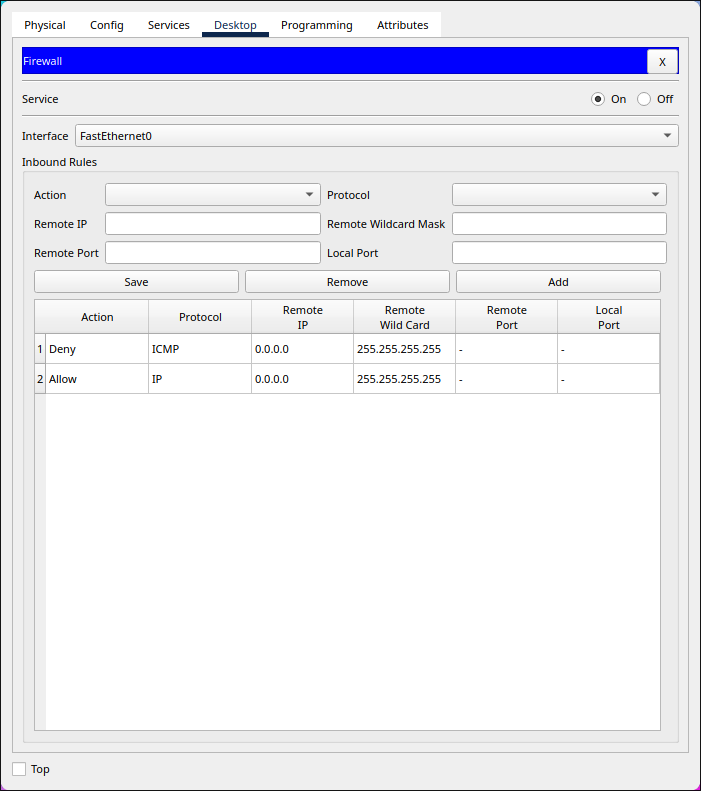
</div>

E abaixo segue como fica o acesso ao DNS `http://unioeste.br` na simulação:

<div align="center">
    
</div>

## Configurações da rede pessoal 

- O servidor DHCP local começa sua distribuição a partir do endereço de sufixo `15`. Exemplo: `192.168.0.15`, tal qual na Unioeste, é importante para manter endereços que possam ser utilizados futuramente.

- Foram utilizados dois dispositivos IOT conectados ao Access-Point, foi necessário alterar o SSID da porta 1 do Access-Point para um personalizado que fosse de acordo com o SSID dos demais dispositivos (`IOT-AP` é o SSID utilizado nos dispositivos e no AP).

- Caso seja feita alguma conexão externa (como envio de ICMP para a Unioeste), o roteador local aplica o protocolo NAT, e ao passar pelo roteador é possível ver com a configuração do pacote muda (em referência a IP origem e IP destino) conforme as capturas de tela abaixo: 

### Conexão rede local e externa

Nesse momento o pacote está sendo preparado para sair de um computador da rede pessoal.

<div align="center">
    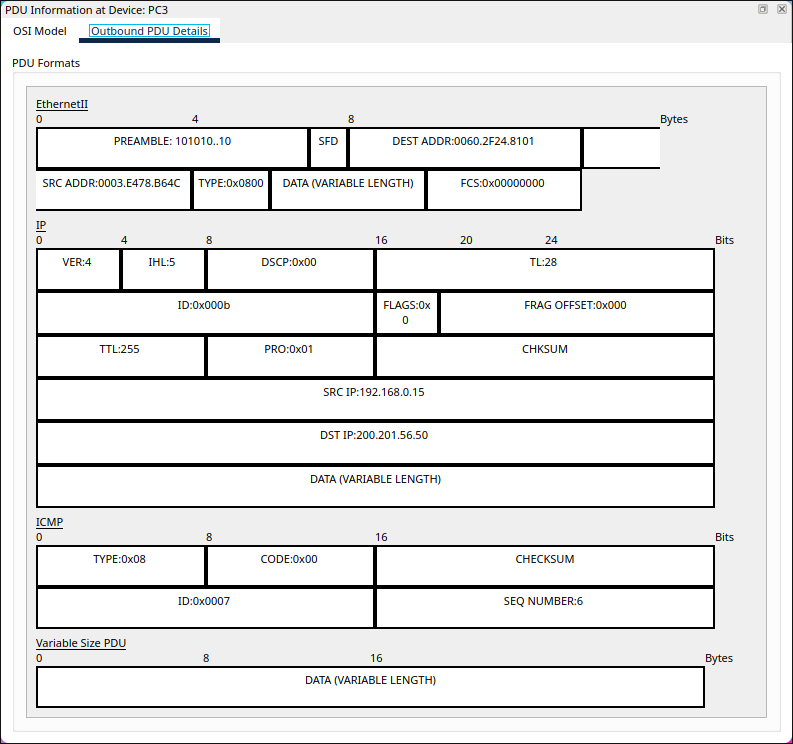
</div>

Aqui o pacote ICMP chega ao roteador da rede pessoal que traduz o IP via NAT para acessar outras redes externas.

<div align="center">
    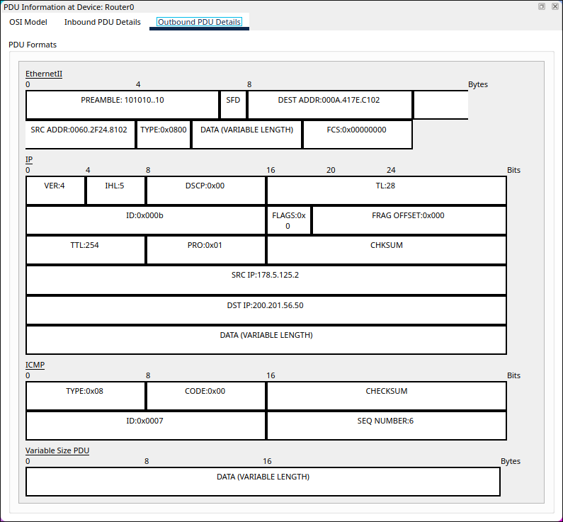
</div>

Abaixo, o pacote ICMP chegou ao computador destino, esse que agora prepara a confirmação de recebimento para a rede doméstica.

<div align="center">
    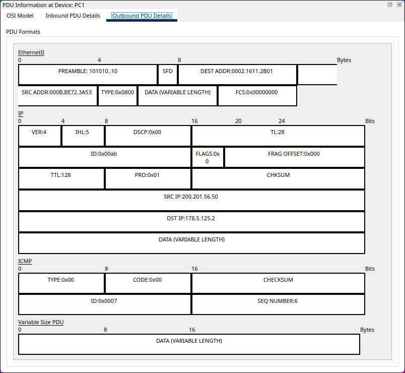
</div>

Por fim, abaixo segue a confirmação de envio e recebimento do pacote com o IP traduzido ao chegar no computador origem.

<div align="center">
    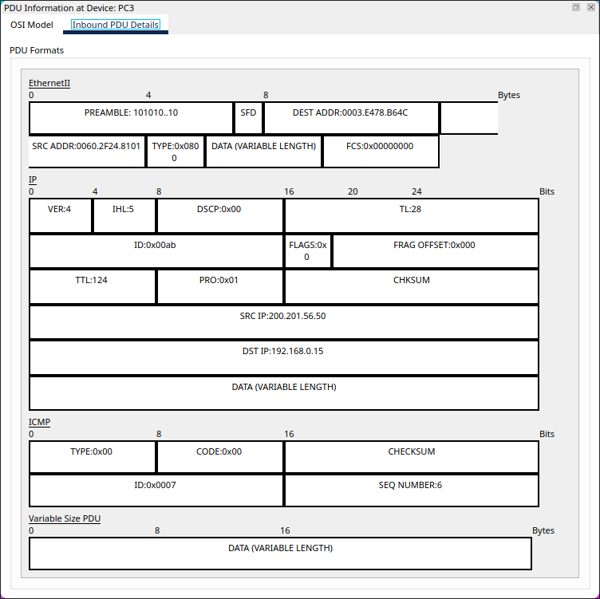
</div>

### Configuração do NAT

Para confirgurar o protocolo NAT foi necessário inserir esses comandos no roteador local:

```sh 
Router>enable
Router#configure terminal
Router(config)#interface gigabitEthernet0/0
Router(config-if)#ip nat inside
Router(config-if)#exit
Router(config)#interface gigabitEthernet0/1
Router(config-if)#ip nat outside
Router(config-if)#exit
Router(config)#access-list 1 permit 192.168.0.0 0.0.0.255
Router(config)#ip nat inside source list 1 interface gigabitEthernet0/1 overload
Router(config)#exit
Router#show ip nat statistics
Router#show ip nat translations
``` 

Os dois últimos comandos apenas para verificar as estatísticas e traduções de cada pacote enviado e recebido. A interface acessada diz respeito ao endereço IP que será utilizado como entrada e saída, no caso, `gigabitEthernet0/0` será utilizado como entrada e `gigabitEthernet0/1` como saída.

Segue abaixo a saída dos últimos comandos:

<div align="center">
    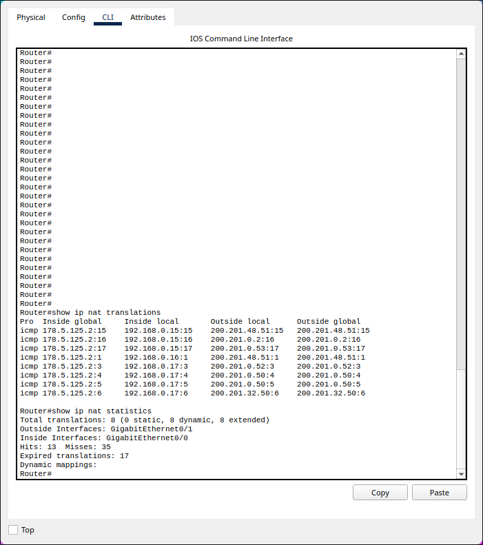
</div>

É possível notar em `Inside global` e `Inside local` como o IP é traduzido para fora (global) e como ele é traduzido quando chega no espaço local.

## Implementação da rede

### Arquitetura

Segue abaixo a arquitetura planejada:

<div align="center">
    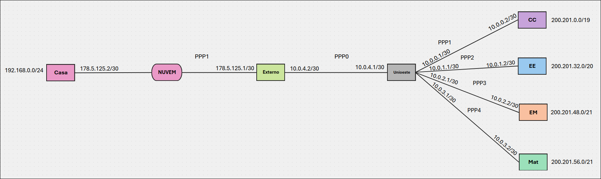
</div>

### Implementação lógica

Na implementação lógica, a rede ficou da seguinte maneira: 

<div align="center">
    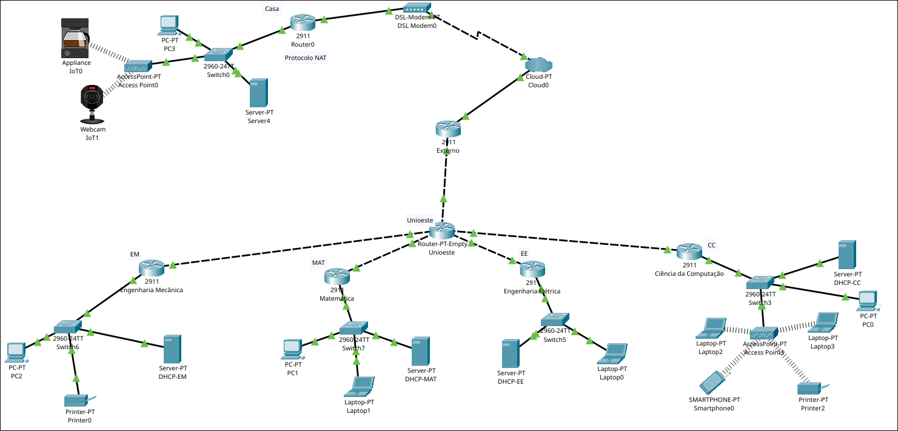
</div>

Apesar de leves mudanças estéticas, o projeto seguiu com a mesma proposta, as mudanças estéticas se limitam a posição verticalizada dos roteadores e a inversão de posição dos dispositivos dedicados ao curso de Matemática com os dispositivos de Engenharia Mecânica, não afetando de maneira alguma a prática.

**Obs.:** A representação da nuvem na arquitetura de rede é apenas estética para demonstrar onde ficaria situada na prática, visto que não seria necessária sua representação por não possuir endereço IP.

### Tabela de roteamento

Os endereços de conexão ponto a ponto estão todos representados no interno das conexões, os endereços externos (como os dos cursos e o endereço da casa) são os endereços utilizados pelos dispositivos (como computadores, servidores e afins). Segue abaixo a tabela de roteamento:

| Rede            | Gateway     | Interface |
|-----------------|-------------|-----------|
| 200.201.0.0/19  | 10.0.0.2    | PPP1      |
| 200.201.32.0/20 | 10.0.1.2    | PPP2      |
| 200.201.48.0/21 | 10.0.2.2    | PPP3      |
| 200.201.56.0/21 | 10.0.3.2    | PPP4      |
| 178.5.125.0/30  | 10.0.4.2    | PPP0      |
| 192.168.0.0/24  | 10.0.4.2    | PPP0      |
| 192.168.0.0/24  | 178.5.125.2 | PPP1      |
| 0.0.0.0/0       | 10.0.4.1    | PPP0      |

**Obs.:** Ficou em questão sobre como aplicar as rotas para o `PPP0`, já que, com o NAT os endereços que desejam ser acessados podem mudar, e talvez não fosse possível ter uma confirmação de entrega de pacote (no cenário de manter somente o `192.168.0.0/24` só seria possível enviar, mas não seria possível receber). Por isso a adição de duas redes com o mesmo gateway.

## Roteamento dinâmico

É possível utilizar uma alternativa mais otimizada para o roteamento estático, tanto otimizada no sentido de custo de trabalho quanto no envio de pacotes. Seria então o roteamento dinâmico, a partir de agora tudo estará fora da rede principal, apenas com a finalidade de explicar como poderia ser utilizado o roteamento dinâmico no trabalho.

<div align="center">
    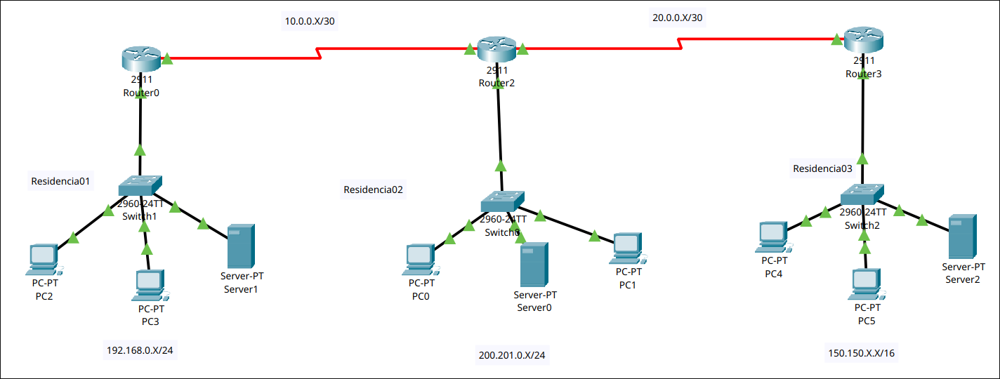
</div>

Como funciona?

- Antes de ligar o roteador, importante adicionar uma porta Serial em cada um dos roteadores (o modelo utilizado é o `2911`, que vem sem as portas Serial). A porta Serial utilizada foi a `HWIC-2T` que disponibiliza 2 portas.

- Após isso é importante definir os endereços locais nos quais os dispositivos farão sua comunicação. Nesse caso, como demonstrado na figura, cada residência possui uma faixa de endereço, segue abaixo uma tabela com a distribuição de IPs.

|       | Rede           |  Máscara      | Inicial     | Final           | Endereço/Rede |
|-------|----------------|---------------|-------------|-----------------|---------------|
| Res01 | 192.168.0.0/24 | 255.255.255.0 | 192.168.0.0 | 192.168.0.255   | 256           |
| Res02 | 200.201.0.0/24 | 255.255.255.0 | 200.201.0.0 | 200.201.0.255   | 256           |
| Res03 | 150.150.0.0/16 | 255.255.0.0   | 150.150.0.0 | 150.150.255.255 | 65,536        |

**Obs.:** Isso é obviamente apenas um exemplo teórico, não seria possível ter 256 endereços em uma residência, muito menos 65,536.

Importante dizer que, todos os dispositivos contêm o IP gateway respectivo da sua rede. Por exemplo, o PC2 contém o IP gateway `192.168.0.1`, distribuído pelo servidor e que é o endereço do roteador local.

Os roteadores possuem na porta Serial o endereço para conexão ponto a ponto, por exemplo, o roteador da primeira residência possui o endereço IP `10.0.0.1/30` em sua porta Serial, o roteador da segunda residência possui os endereços `10.0.0.2/30` e `20.0.0.1/30`. O roteador da terceira residência possui o endereço `20.0.0.2/30`. Importante que se diga que todos os roteadores possuem sua rede local, claro. Para a conexão ponto a ponto funcionar, deve ser estabelecida as seguintes rotas na aba RIP (dentro de cada roteador):

Para o roteador da esquerda, segue as rotas RIP.

<div align="center">
    
</div>

Para o roteador do meio, segue as rotas RIP.

<div align="center">
    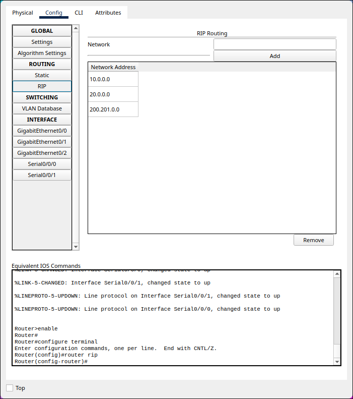
</div>

Para o roteador da direita, segue as rotas RIP.

<div align="center">
    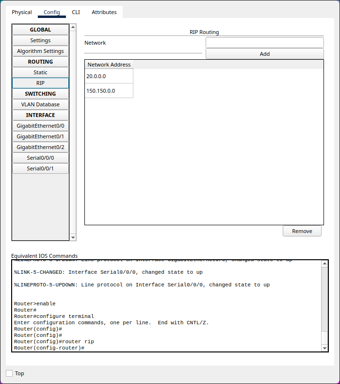
</div>

Com isso, vale ressaltar a facilidade em relação as rotas estáticas, já que, nesse caso não é necessário nem mesmo informar a máscara e nem endereços específicos, facilitando a inclusão de rotas para a passagem de dados.

## Referências 

tuta_nerd, **CCNA R&S - Como configurar NAT Network Address Translation [AULA 21]**. Youtube, 8 de outubro de 2021. Disponível em: https://www.youtube.com/watch?v=S4SMW4Tew_k&t=554s. Acesso em: 12 de dez. de 2025.

GEEKSFORGEEKS. **Basic Firewall Configuration in Cisco Packet Tracer**. Disponível em: https://www.geeksforgeeks.org/computer-networks/basic-firewall-configuration-in-cisco-packet-tracer/. Acesso em: 12 de dez. de 2025.

Studocu. **Cisco Packet Tracer: Configuração de Servidores DHCP, DNS e HTTP**. Disponível em: https://www.studocu.com/pt-br/document/cooperativa-de-ensino-alvares-cabral/filosofia/cisco-packet-tracer-configuracao-de-servidores-dhcp-dns-e-http/124735505. Acesso em: 13 de dez. de 2025.

GEEKSFORGEEKS. **RIP Routing Configuration Using 3 Routers in Cisco Packet Tracer**. Disponível em: https://www.geeksforgeeks.org/computer-networks/rip-routing-configuration-using-3-routers-in-cisco-packet-tracer/. Acesso em: 14 de dez. de 2025.
